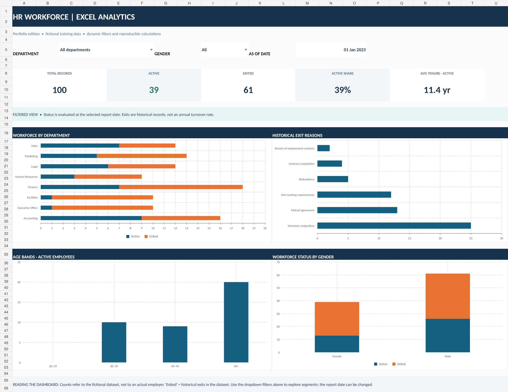

# HR Workforce Analytics | Interactive Excel Dashboard

## Project overview

An interactive **Microsoft Excel workforce-analysis dashboard** based on a fictional, 100-record HR dataset from a DAN.IT Education coursework assignment (March 2026). The coursework project was expanded and reorganized into a portfolio edition in November 2026, with clearer metric definitions, dynamic reporting dates, formula-driven summaries, and data-quality checks.

This is a **training project using entirely fictional records**, not a report about a real employer.

## Business questions

- What is the size of the recorded workforce at a selected reporting date?
- How are active and exited employees distributed across departments and gender groups?
- Which reasons for leaving appear most frequently in the historical records?
- How do age groups and average tenure differ within selected segments?
- Which entries merit manual review for potential data-quality issues?

## Key results | 1 January 2023

| Metric | Result |
|---|---:|
| Employee records | **100** |
| Departments | **8** |
| Active employees | **39** |
| Historical exited employees | **61** |
| Active share of recorded cohort | **39%** |
| Average tenure of active employees | **11.4 years** |
| Largest department by recorded entries | **Finance (18)** |
| Most frequent recorded exit reason | **Voluntary resignation (25)** |
| Records flagged for age-at-hire review | **14** (7 under 18; 7 over 65) |

**Interpretation warning:** 61 historical exited records out of 100 entries is **not an annual employee turnover rate**. The source is a synthetic cohort of employee records, not an audited period-by-period movement history. Age thresholds are illustrative review prompts rather than evidence of errors or employment ineligibility.

## Excel techniques

- **Data preparation:** structured employee records, date fields, consistent category labels
- **Calculated fields:** status as of a selected date, completed age, tenure, age bands, review flags
- **Formula-driven analysis:** `COUNTIFS`, `SUMIFS`, `COUNTIF`, `DATEDIF`, `YEARFRAC`, `IF`, `IFERROR`
- **Interactivity:** dropdown filters for department and gender, adjustable report date
- **Visualization:** four linked charts and five KPI cards
- **Quality checks:** duplicate identifiers, implausible or unusual ages at hire, inconsistent dates and missing exit reasons
- **Documentation:** separate calculation tables, validation sheet and methodology notes

The original course assignment used PivotTables and slicers. This revised public version deliberately uses **transparent formula-driven summaries and dropdown filters** that can be audited directly in Excel.

## Workbook structure

| Sheet | Purpose |
|---|---|
| `Dashboard` | Interactive KPI cards and four charts; change department, gender, or reporting date |
| `Analysis` | Formula-driven data tables behind the charts and KPI cards |
| `Employee_Data` | Fictional source records plus calculated fields and a review flag |
| `Data_Quality` | Checks and important interpretation cautions |
| `Methodology` | Definitions, methodology, limitations, and instructions |

## How to explore

1. Download **[Excel_HR_Workforce_Portfolio.xlsx](Excel_HR_Workforce_Portfolio.xlsx)** and open it in Microsoft Excel.
2. Go to `Dashboard`.
3. Use the **Department** and **Gender** dropdowns to filter the dashboard.
4. Change the **As of date** (default: **01 Jan 2023**) to inspect historical status and tenure calculations.
5. Visit `Analysis` to inspect the formulas; see `Data_Quality` and `Methodology` for the assumptions.

The workbook contains no macros and does not require external corporate data connections. For full chart/formula recalculation, open it in desktop Excel.

## Limitations and responsible interpretation

- All names, employment dates and exits are **fictional** course data.
- An age-at-hire review flag is **not** evidence of an actual error or legal issue. Flagged records remain in the analysis pending review.
- The sample is small, artificial and not representative of a real company; **do not infer causality or real-world HR policy outcomes**.
- The project demonstrates spreadsheet analytics, not production HR reporting or enterprise BI deployment.

**Context:** DAN.IT Education, Data Analytics professional program, 2026. Original Excel coursework completed in March 2026; portfolio improvements added in November 2026.
